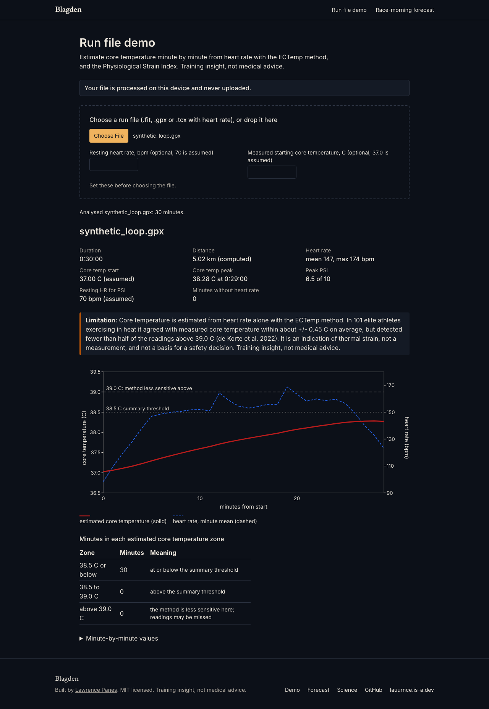

# Blagden

Heat intelligence for runners in the tropics: core temperature from your heart rate, race-morning WBGT for Metro Manila venues, and a heat-adjusted pace plan.

The banner is animated. Click it, or open [blagden.vercel.app](https://blagden.vercel.app), to try the live demo: drop in a run file and watch the estimate build, minute by minute, on your own device.

## Why

A Manila race morning is often above 26 C with humidity over 80 percent before the gun goes off, and the sun is up within the first hour. In that air sweat evaporates slowly, so a pace that feels easy in the cool can push core temperature high. Blagden puts numbers on that for a runner: how hot your body likely ran, how hot race morning will be, and what pace that heat allows.
