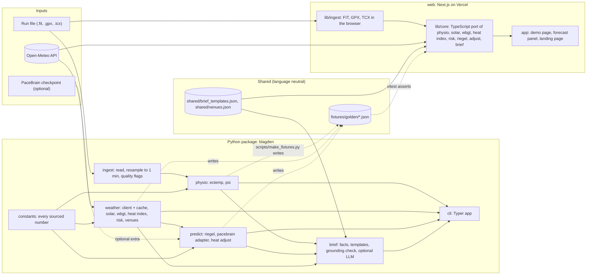

# Blagden architecture

This document describes how Blagden is built: the modules, their public interfaces, the data that flows between them, how the Python and TypeScript implementations are kept identical, how everything is tested and deployed, and the day-by-day build plan. The science behind each number is in docs/SCIENCE.md; decisions and their reasons are in docs/DECISIONS.md.

## 1. System overview



Reading the diagram:

- The run file never leaves the device. In the CLI it is read from disk; in the web demo it is parsed in the browser by `lib/ingest` and never uploaded.
- Weather enters from Open-Meteo. The CLI fetches through the Python client with an on-disk cache; the browser fetches directly from the user's device (D-003, D-010).
- Python is the reference implementation. The TypeScript core is a port, and the golden fixtures are the contract between them (section 4).
- `constants` is the single place where a sourced number lives. Every entry names its section in docs/SCIENCE.md and its status, and a test fails if any UNVERIFIED value is referenced by code.
- Shared JSON files hold the brief templates and venue presets, so both languages read the same text and coordinates.

## 2. Modules and public interfaces

Repository layout (D-005):

```
blagden/
  pyproject.toml            uv project, package name blagden, Python >= 3.12
  src/blagden/              the Python package
  tests/                    pytest suites, mirrors src layout
  scripts/make_fixtures.py  writes fixtures/golden from the Python reference
  fixtures/golden/          JSON fixtures shared with the TypeScript tests
  fixtures/synthetic/       synthetic .fit, .gpx, .tcx run files
  shared/                   brief_templates.json, venues.json
  web/                      Next.js app (pnpm), lib/core and lib/ingest
  docs/                     SCIENCE, ARCHITECTURE, DECISIONS, PROGRESS, PROJECT_BRIEF
  .github/workflows/ci.yml
```

Conventions for every public function: keyword-only options, units in parameter and field names (`_c`, `_bpm`, `_mps`, `_hpa`, `_wm2`, `_s`, `_km`, `_deg`, `_pct`), frozen dataclasses for results, `None` or `math.nan` for missing values, no printing and no network access outside `weather.client`. Pure-math modules that are ported to TypeScript are marked **ported**.

### 2.1 blagden.constants

Every number that comes from a source lives here, nowhere else.

```python
from dataclasses import dataclass
from typing import Literal

@dataclass(frozen=True)
class Const:
    value: float
    unit: str
    name: str
    science_section: str        # for example "1" or "4"
    source: str                 # short citation as in docs/SCIENCE.md
    status: Literal["VERIFIED", "VERIFIED_SECONDARY", "DERIVED", "BLAGDEN_CHOICE"]

ECTEMP_GAMMA = Const(0.022, "C/min", "process noise SD", "1", "US10702165B2; Hunt 2019", "VERIFIED")
ECTEMP_B0 = Const(-7887.1, "bpm", "observation intercept", "1", "US10702165B2; Hunt 2019", "VERIFIED")
# ... one entry per row of the SCIENCE.md parameter tables

def all_constants() -> dict[str, Const]: ...
```

An UNVERIFIED status does not exist in this enum on purpose: a value that is UNVERIFIED in docs/SCIENCE.md cannot be written here, so it cannot reach code. A test checks that every constant's section exists in docs/SCIENCE.md and that every numeric literal in `physio`, `weather` and `predict` is either a constant reference or on an allow-list of structural numbers (0, 1, 2, 100, 60, 1000).

### 2.2 blagden.ingest

Reads the three formats into one sample table and produces the one-minute series that `physio` consumes.

```python
from pathlib import Path
from typing import BinaryIO, Literal
import numpy as np

@dataclass(frozen=True)
class Samples:
    """Raw samples as parsed, one row per record. Arrays share length n."""
    time_utc_s: np.ndarray      # float64, Unix seconds, UTC, non-decreasing
    hr_bpm: np.ndarray          # float64, NaN where absent or invalid
    lat_deg: np.ndarray         # float64, NaN where absent
    lon_deg: np.ndarray
    alt_m: np.ndarray
    speed_mps: np.ndarray
    dist_m: np.ndarray          # cumulative, NaN where absent
    cadence_rpm: np.ndarray     # as stored by the device (one foot), NaN where absent
    segment_id: np.ndarray      # int32, increments at each recording pause or GPX trkseg
    source_format: Literal["fit", "gpx", "tcx"]
    sport: str | None           # "running", "trail", ... when the file says so
    local_utc_offset_s: int | None  # from FIT local_timestamp or TCX designator; None if unknown

@dataclass(frozen=True)
class MinuteSeries:
    """One-minute means aligned to the first valid heart-rate sample."""
    start_utc_s: float
    hr_bpm: np.ndarray          # float64, NaN where no observation this minute
    n_samples: np.ndarray       # int32, samples averaged into the minute
    segment_id: np.ndarray      # int32
    flags: tuple[frozenset[str], ...]   # per minute: "gap", "interpolated", "low_support", "cadence_lock", "out_of_range", "pause"
    cadence_rpm: np.ndarray     # mean cadence, for flag audit only

def read_activity(src: str | Path | BinaryIO, *, fmt: Literal["fit", "gpx", "tcx"] | None = None) -> Samples:
    """Detect the format from the extension or magic bytes unless fmt is given."""

def resample_minutes(samples: Samples, *, max_interp_gap_min: int = 5, min_support: int = 3,
                     hr_valid_range_bpm: tuple[float, float] = (25.0, 250.0)) -> MinuteSeries:
    """Apply the ECTemp one-minute rule and Blagden's gap, support and range flags (SCIENCE.md section 8)."""

def detect_cadence_lock(minutes: MinuteSeries, *, tolerance_bpm: float = 3.0, min_run_min: int = 3) -> MinuteSeries:
    """Flag minutes where heart rate tracks cadence (one foot or two feet) for min_run_min consecutive minutes."""
```

Change from the proposal: `cadence_rpm` and `dist_m` are added to the table (cadence is needed for the cadence-lock flag, distance for pace display), `segment_id` carries recording pauses so gaps are not interpolated across a stop, and quality flags live on the minute series rather than in `physio`, because they are facts about the recording, not about physiology.

### 2.3 blagden.physio (ported)

```python
@dataclass(frozen=True)
class EctempParams:
    ct0_c: float = 37.0                 # D-012 default
    var0_c2: float = 0.01               # D-012 default
    model: Literal["quadratic_2013"] = "quadratic_2013"

@dataclass(frozen=True)
class CoreTempSeries:
    ct_c: np.ndarray                    # float64 per minute
    var_c2: np.ndarray                  # filter variance per minute
    gain: np.ndarray                    # Kalman gain used per minute (0 where no observation)
    observed: np.ndarray                # bool, False where the minute had no heart rate
    loa_c: float                        # 0.63, published 95 percent limits of agreement (SCIENCE.md 1)
    confidence: tuple[Literal["high", "medium", "low"], ...]   # from ingest flags and observed
    caveats: tuple[str, ...]            # always includes the above-39.0 C sensitivity statement (SCIENCE.md 2)
    params: EctempParams

def ectemp_step(ct_prev_c: float, var_prev_c2: float, hr_bpm: float | None) -> tuple[float, float, float]:
    """One time update plus, when hr_bpm is given, one measurement update. Returns (ct_c, var_c2, gain)."""

def ectemp(minutes: MinuteSeries, params: EctempParams = EctempParams()) -> CoreTempSeries: ...

@dataclass(frozen=True)
class PsiSeries:
    psi: np.ndarray                     # float64, NaN where ct or hr missing
    above_scale: np.ndarray             # bool, psi > 10
    ct0_c: float
    hr0_bpm: float
    hr0_defaulted: bool                 # True when the 70 bpm default was used (D-014)

def psi(core: CoreTempSeries, minutes: MinuteSeries, *, hr0_bpm: float | None = None) -> PsiSeries: ...
```

### 2.4 blagden.weather

A package. I/O in `client` and `cache`; pure math in `solar`, `wbgt`, `heatindex`, `risk` (all ported); data in `venues`.

```python
# blagden.weather.venues
@dataclass(frozen=True)
class Venue:
    id: str                 # "moa", "bgc", "up_diliman", "filinvest", "clark"
    name: str
    lat_deg: float
    lon_deg: float
    tz: str                 # IANA, "Asia/Manila"
    surface: Literal["urban", "rural"]   # selects the wind-profile exponent set (SCIENCE.md 4)

def load_venues(path: Path | None = None) -> tuple[Venue, ...]:   # reads shared/venues.json

# blagden.weather.client
@dataclass(frozen=True)
class HourlyWeather:
    time_utc_s: float
    t_air_c: float
    rh_pct: float
    dewpoint_c: float
    wind10_mps: float
    pressure_hpa: float
    cloud_pct: float
    ghi_wm2: float          # shortwave_radiation_instant
    direct_wm2: float       # direct_radiation_instant, horizontal plane
    diffuse_wm2: float      # diffuse_radiation_instant
    model: str              # Open-Meteo model name reported
    fetched_utc_s: float

class OpenMeteoClient:
    def __init__(self, *, cache_dir: Path | None = None, ttl_s: int = 3600,
                 base_url: str = "https://api.open-meteo.com/v1/forecast",
                 archive_url: str = "https://archive-api.open-meteo.com/v1/archive",
                 timeout_s: float = 10.0) -> None: ...
    def forecast(self, venue: Venue, start_utc_s: float, end_utc_s: float) -> tuple[HourlyWeather, ...]: ...
    def archive(self, venue: Venue, start_utc_s: float, end_utc_s: float) -> tuple[HourlyWeather, ...]: ...
    attribution: str = "Weather data by Open-Meteo.com (CC BY 4.0)"

# blagden.weather.solar  (ported)
def cos_zenith(time_utc_s: float, lat_deg: float, lon_deg: float) -> float:
    """Astronomical Almanac low-precision formulas as in the Liljegren code; clipped at 0."""

# blagden.weather.wbgt  (ported)
@dataclass(frozen=True)
class WbgtPoint:
    time_utc_s: float
    wbgt_c: float
    tnwb_c: float
    tg_c: float
    t_air_c: float
    wind2_mps: float
    cos_zenith: float
    fdir: float
    model_error_c: float            # 1.0, from the validation statements in SCIENCE.md 4
    flags: frozenset[str]           # "sun_down", "out_of_range", "no_convergence"

def wbgt(t_air_c: float, rh_pct: float, pressure_hpa: float, wind10_mps: float,
         ghi_wm2: float, direct_wm2: float, diffuse_wm2: float, cos_zenith: float,
         *, surface: Literal["urban", "rural"] = "urban") -> WbgtPoint: ...

def wbgt_series(hours: tuple[HourlyWeather, ...], venue: Venue) -> tuple[WbgtPoint, ...]: ...

# blagden.weather.heatindex  (ported)
def heat_index_c(t_air_c: float, rh_pct: float) -> float:
    """NWS Rothfusz procedure including the simple-formula gate and both adjustments (SCIENCE.md 5)."""

def pagasa_category(hi_c: float) -> Literal["not_hazardous", "caution", "extreme_caution", "danger", "extreme_danger"]:
    """Rounds to the nearest whole degree before classifying (D-017)."""

# blagden.weather.risk  (ported)
@dataclass(frozen=True)
class RiskLabel:
    flag: Literal["white", "green", "yellow", "red", "black"]
    racinais_level: Literal["below_moderate", "moderate", "high", "excessive"]
    acsm2007_text: str
    wa2020_band: Literal["almost_safe", "caution", "warning", "severe_warning", "danger"]

def risk_label(wbgt_c: float, rh_pct: float) -> RiskLabel: ...
```

Change from the proposal: `risk` and `venues` are added; solar, WBGT, heat index and risk are split from the client so the pure-math files map one to one onto `web/lib/core`.

### 2.5 blagden.predict (ported except the PaceBrain adapter)

```python
from typing import Protocol, Mapping

@dataclass(frozen=True)
class BaselinePrediction:
    distance_km: float
    time_s: float
    lo_s: float | None              # None when the predictor gives no interval
    hi_s: float | None
    source: Literal["riegel", "pacebrain", "manual"]
    inputs: Mapping[str, float]
    warnings: tuple[str, ...]       # for example "outside PaceBrain training range"

class BaselinePredictor(Protocol):
    def predict(self, distance_km: float) -> BaselinePrediction: ...

class RiegelPredictor:
    def __init__(self, *, known_distance_km: float, known_time_s: float, exponent: float = 1.06,
                 interval_fraction: float | None = None) -> None:
        """exponent from SCIENCE.md 6. interval_fraction is a declared assumption, not a sourced value;
        None means no interval."""
    def predict(self, distance_km: float) -> BaselinePrediction: ...

@dataclass(frozen=True)
class HeatAdjustedPrediction:
    time_s: float
    lo_s: float
    hi_s: float
    level: Literal["elite", "nonelite"]
    k_per_c: float
    wbgt_race_c: float
    wbgt_base_c: float
    delta_wbgt_c: float
    extrapolated: bool
    baseline_wbgt_defaulted: bool
    baseline: BaselinePrediction

def runner_level(baseline: BaselinePrediction) -> Literal["elite", "nonelite"]:
    """Elite if the marathon-equivalent time (Riegel-scaled to 42.195 km) is under 2:30:00 (D-015)."""

def heat_adjust(baseline: BaselinePrediction, wbgt_race_c: float, *, wbgt_base_c: float | None = None,
                level: Literal["elite", "nonelite"] | None = None) -> HeatAdjustedPrediction:
    """D-015 formula with slope ranges and the doubling above 25 C."""
```

### 2.6 blagden.brief (facts and rendering ported; LLM path Python only)

```python
@dataclass(frozen=True)
class Brief:
    """Every number the text may contain, already formatted as strings in the units shown."""
    venue_name: str
    window_local: str                   # "04:00 to 09:00 PHT"
    wbgt_by_hour: tuple[tuple[str, str, str], ...]    # (local_time, wbgt_c_text, flag)
    heat_index_peak: tuple[str, str]    # (hi_c_text, pagasa_category)
    pace_cap_min_per_km: str | None
    finish_point: str | None            # "4:12:30"
    finish_range: tuple[str, str] | None
    back_off_time_local: str | None     # first hour whose flag is red or worse
    core_temp_peak_c: str | None        # from a run file, when given
    psi_peak: str | None
    caveats: tuple[str, ...]            # fixed sentences from SCIENCE.md 2 and 6
    attribution: str
    allowed_numbers: frozenset[str]     # every numeric token above, for grounding

def build_brief(*, venue: Venue, window_utc_s: tuple[float, float], wbgt: tuple[WbgtPoint, ...],
                heat_index: tuple[tuple[float, float], ...], prediction: HeatAdjustedPrediction | None,
                core: CoreTempSeries | None, psi_series: PsiSeries | None) -> Brief: ...

def render_brief(brief: Brief, *, templates_path: Path | None = None) -> str:
    """Fills shared/brief_templates.json. Placeholders are {name}; no logic in templates."""

@dataclass(frozen=True)
class GroundingResult:
    ok: bool
    unknown_numbers: tuple[str, ...]
    forbidden_words: tuple[str, ...]

def ground_check(text: str, brief: Brief, *, forbidden: tuple[str, ...] = ("diagnose", "safe", "guaranteed", "cure")) -> GroundingResult:
    """Extracts every numeric token (including 6:05/km and 2:15:40 forms) and checks it against brief.allowed_numbers."""

class LLMProvider(Protocol):
    name: str
    def rewrite(self, template_text: str, brief: Brief) -> str: ...

def rewrite_with_llm(brief: Brief, template_text: str, provider: LLMProvider) -> str:
    """Returns provider text only when ground_check passes; otherwise returns template_text and logs the rejection."""
```

Providers are selected by a `provider` setting (for example openai or anthropic). The core package declares no provider SDK; a provider module imports its SDK lazily and is installed through an extra. The feature is off by default (D-007).

### 2.7 blagden.cli

A Typer application installed as the `blagden` command.

```
blagden analyze RUNFILE [--start-temp-c 37.0] [--start-var 0.01] [--resting-hr 70] [--json] [--csv OUT]
blagden forecast VENUE_ID --date YYYY-MM-DD [--from 04:00] [--to 09:00] [--json] [--no-cache]
blagden predict --distance-km 42.195 --known-distance-km 21.1 --known-time 1:52:30 --wbgt 27.5 [--baseline-wbgt 10] [--json]
blagden brief VENUE_ID --date YYYY-MM-DD [--run RUNFILE] [--predict ...] [--llm PROVIDER]
blagden venues
blagden version
```

Every command has `--json` so the web demo and the fixtures can be checked against CLI output.

### 2.8 web

```
web/
  app/                 Next.js App Router: / (landing), /demo (run file analysis), /forecast (venue WBGT)
  lib/core/            TypeScript port: constants.ts, ectemp.ts, psi.ts, solar.ts, wbgt.ts, heatindex.ts, risk.ts, riegel.ts, adjust.ts, brief.ts
  lib/ingest/          fit.ts (fit-file-parser), gpx.ts and tcx.ts (DOMParser, namespace aware), resample.ts
  lib/weather/         openMeteo.ts (browser fetch, D-010 request shape)
  tests/               vitest unit and parity tests; e2e/ Playwright
```

Function names and field names in `lib/core` are the camelCase spelling of the Python names (`ectempStep`, `heatIndexC`), and JSON keys are identical snake_case in both languages so fixtures need no mapping.

Change from the proposal: WBGT, solar, heat index, risk and the brief renderer are ported, not only the filter, because the forecast panel runs in the browser (D-003) and the brief is shown there. The LLM path is not ported.

## 3. Data contracts

Rules that apply to every shape below:

- Keys are snake_case and identical in Python and TypeScript. Fixtures therefore need no field mapping.
- Units are in the key name: `_c` degrees Celsius, `_c2` degrees Celsius squared, `_bpm` beats per minute, `_mps` metres per second, `_hpa` hectopascals, `_wm2` watts per square metre, `_s` seconds, `_km` kilometres, `_deg` degrees, `_pct` percent, `_m` metres.
- Time inside the package and in fixtures is `time_utc_s`, Unix seconds as a number. CLI `--json` output and the web UI add `time_local` as ISO 8601 with the venue offset, for people.
- Missing numbers are `null` in JSON and `NaN` in arrays. Booleans are never missing.
- Every result that a person will read carries `caveats` (fixed sentences from docs/SCIENCE.md) and, where a model error is known, `model_error_c`.

### 3.1 Minute series (ingest to physio)

```json
{
  "start_utc_s": 1773187200.0,
  "hr_bpm": [142.3, 145.0, null, 151.2],
  "n_samples": [58, 60, 0, 31],
  "segment_id": [0, 0, 0, 0],
  "flags": [[], [], ["gap", "interpolated"], ["low_support"]],
  "cadence_rpm": [86.0, 87.1, null, 86.4]
}
```

Flag vocabulary: `gap` (no sample in the minute), `interpolated` (value filled across a gap of 5 minutes or less), `pause` (inside a recording pause, never interpolated), `low_support` (fewer than 3 samples), `cadence_lock` (heart rate tracked cadence for 3 or more minutes), `out_of_range` (sample outside 25 to 250 bpm, excluded).

### 3.2 Core temperature series (physio output)

```json
{
  "ct_c": [37.004, 37.021, 37.021, 37.047],
  "var_c2": [0.0098, 0.0097, 0.0102, 0.0100],
  "gain": [0.00128, 0.00124, 0.0, 0.00121],
  "observed": [true, true, false, true],
  "loa_c": 0.63,
  "confidence": ["high", "high", "low", "medium"],
  "caveats": [
    "Estimated from heart rate alone with the ECTemp method; not a measurement.",
    "In 101 elite athletes exercising in heat the method detected fewer than half of readings above 39.0 C (de Korte et al. 2022)."
  ],
  "params": {"ct0_c": 37.0, "var0_c2": 0.01, "model": "quadratic_2013"}
}
```

Confidence rule: `high` when observed and no flags; `medium` when `low_support` or `interpolated`; `low` when `cadence_lock`, `pause`, `gap`, or when `ct_c` is above 39.0.

### 3.3 PSI series

```json
{"psi": [0.0, 0.4, null, 1.1], "above_scale": [false, false, false, false],
 "ct0_c": 37.0, "hr0_bpm": 70.0, "hr0_defaulted": true}
```

### 3.4 Hourly weather (client output; also the shape the browser builds from the Open-Meteo response)

```json
{"time_utc_s": 1773180000.0, "t_air_c": 26.4, "rh_pct": 88.0, "dewpoint_c": 24.3,
 "wind10_mps": 1.9, "pressure_hpa": 1008.2, "cloud_pct": 40.0,
 "ghi_wm2": 0.0, "direct_wm2": 0.0, "diffuse_wm2": 0.0,
 "model": "best_match", "fetched_utc_s": 1773100000.0}
```

### 3.5 WBGT point

```json
{"time_utc_s": 1773187200.0, "wbgt_c": 27.9, "tnwb_c": 25.6, "tg_c": 38.1, "t_air_c": 28.0,
 "wind2_mps": 1.3, "cos_zenith": 0.42, "fdir": 0.71, "model_error_c": 1.0, "flags": []}
```

### 3.6 Heat index point and risk label

```json
{"time_utc_s": 1773187200.0, "hi_c": 32.0, "hi_f": 89.6, "pagasa_category": "caution"}
```

```json
{"flag": "red", "racinais_level": "high",
 "acsm2007_text": "Risk for unfit, nonacclimatized individuals is high",
 "wa2020_band": "warning"}
```

### 3.7 Baseline and heat-adjusted prediction

```json
{"distance_km": 42.195, "time_s": 14400.0, "lo_s": null, "hi_s": null, "source": "riegel",
 "inputs": {"known_distance_km": 21.1, "known_time_s": 6600.0, "exponent": 1.06}, "warnings": []}
```

```json
{"time_s": 15955.0, "lo_s": 15437.0, "hi_s": 16992.0, "level": "nonelite", "k_per_c": 0.006,
 "wbgt_race_c": 28.0, "wbgt_base_c": 10.0, "delta_wbgt_c": 18.0,
 "extrapolated": true, "baseline_wbgt_defaulted": true, "baseline": {"...": "as above"}}
```

### 3.8 Brief

```json
{"venue_name": "SM Mall of Asia grounds", "window_local": "04:00 to 09:00 PHT",
 "wbgt_by_hour": [["04:00", "25.1", "red"], ["05:00", "25.0", "red"], ["06:00", "26.2", "red"], ["07:00", "28.4", "black"]],
 "heat_index_peak": ["34", "extreme_caution"],
 "pace_cap_min_per_km": "6:20", "finish_point": "4:25:55", "finish_range": ["4:17:17", "4:43:12"],
 "back_off_time_local": "07:00", "core_temp_peak_c": null, "psi_peak": null,
 "caveats": ["..."], "attribution": "Weather data by Open-Meteo.com (CC BY 4.0)",
 "allowed_numbers": ["04:00", "09:00", "25.1", "25.0", "26.2", "28.4", "34", "6:20", "4:25:55", "4:17:17", "4:43:12", "07:00"]}
```

`allowed_numbers` is computed by `build_brief` from every other field, so the grounding check and the template renderer always agree on what may appear in the text.

### 3.9 Synthetic run files

`fixtures/synthetic/` holds small .fit, .gpx and .tcx files written by `scripts/make_synthetic_runs.py` from a documented heart-rate model (warm-up ramp, steady state, surges, a pause, a dropout, a cadence-lock stretch). Each file has a sidecar JSON with the intended minute means so the ingest tests assert against known truth. No real track is ever committed (PROJECT_BRIEF privacy rule).
