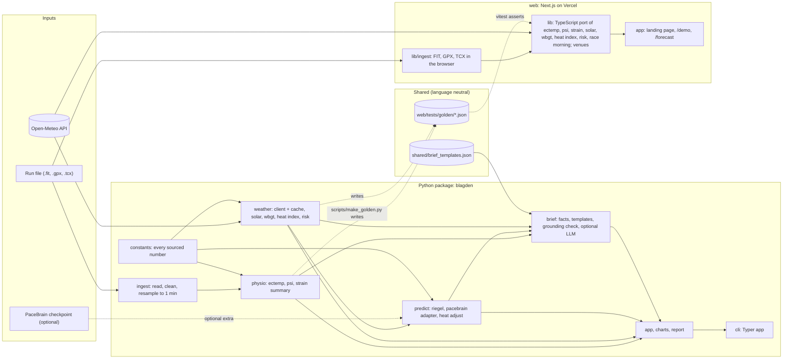

# Blagden architecture

This document describes how Blagden is built: the modules, their public interfaces, the data that flows between them, how the Python and TypeScript implementations are kept identical, how everything is tested and deployed, and the day-by-day build plan. The science behind each number is in docs/SCIENCE.md; decisions and their reasons are in docs/DECISIONS.md.

## 1. System overview



Reading the diagram:

- The run file never leaves the device. In the CLI it is read from disk; in the web demo it is parsed in the browser by `lib/ingest` and never uploaded.
- Weather enters from Open-Meteo. The CLI fetches through the Python client with an on-disk cache; the browser fetches directly from the user's device (D-003, D-010).
- Python is the reference implementation. The TypeScript core is a port, and the golden fixtures are the contract between them (section 4).
- `constants` is the single place where a sourced number lives. Every entry names its section in docs/SCIENCE.md and its status, and a test fails if any UNVERIFIED value is referenced by code.
- Shared JSON files hold the brief templates and venue presets, so both languages read the same text and coordinates.

## 2. Modules and public interfaces

Repository layout (D-005):

```
blagden/
  pyproject.toml            uv project, package name blagden, Python >= 3.12
  src/blagden/              the Python package
  tests/                    pytest suites, mirrors src layout
  scripts/make_golden.py    writes web/tests/golden from the Python reference
  web/tests/golden/         JSON fixtures shared with the TypeScript tests
  tests/fixtures/           synthetic .gpx and .tcx run files
  shared/                   brief_templates.json, venues.json
  web/                      Next.js app (pnpm), lib/core and lib/ingest
  docs/                     SCIENCE, ARCHITECTURE, DECISIONS, PROGRESS, PROJECT_BRIEF
  .github/workflows/ci.yml
```

Conventions for every public function: keyword-only options, units in parameter and field names (`_c`, `_bpm`, `_mps`, `_hpa`, `_wm2`, `_s`, `_km`, `_deg`, `_pct`), frozen dataclasses for results, `None` or `math.nan` for missing values, no printing and no network access outside `weather.client`. Pure-math modules that are ported to TypeScript are marked **ported**.

### 2.1 blagden.constants

Every number that comes from a source lives here, nowhere else.

```python
from dataclasses import dataclass
from typing import Literal

@dataclass(frozen=True)
class Const:
    value: float
    unit: str
    name: str
    science_section: str        # for example "1" or "4"
    source: str                 # short citation as in docs/SCIENCE.md
    status: Literal["VERIFIED", "VERIFIED_SECONDARY", "DERIVED", "BLAGDEN_CHOICE"]

ECTEMP_GAMMA = Const(0.022, "C/min", "process noise SD", "1", "US10702165B2; Hunt 2019", "VERIFIED")
ECTEMP_B0 = Const(-7887.1, "bpm", "observation intercept", "1", "US10702165B2; Hunt 2019", "VERIFIED")
# ... one entry per row of the SCIENCE.md parameter tables

def all_constants() -> dict[str, Const]: ...
```

An UNVERIFIED status does not exist in this enum on purpose: a value that is UNVERIFIED in docs/SCIENCE.md cannot be written here, so it cannot reach code. A test checks that every constant's section exists in docs/SCIENCE.md and that every numeric literal in `physio`, `weather` and `predict` is either a constant reference or on an allow-list of structural numbers (0, 1, 2, 100, 60, 1000).

### 2.2 blagden.ingest

Reads the three formats into one cleaned table and produces the one-minute series that `physio` consumes. Built in B6; rules in docs/SCIENCE.md section 8 and D-021.

```python
# blagden.ingest.table
class IngestError(ValueError): ...
class UnsupportedFormatError(IngestError): ...
class EmptyActivityError(IngestError): ...
class NoHeartRateError(IngestError): ...

class RawRecord(NamedTuple):          # one parsed record, before cleaning
    time_utc: datetime | None         # timezone-aware UTC
    hr_bpm: float | None = None
    lat_deg: float | None = None
    lon_deg: float | None = None
    alt_m: float | None = None
    speed_mps: float | None = None
    distance_m: float | None = None

@dataclass(frozen=True)
class RawActivity:
    records: tuple[RawRecord, ...]
    source_format: Literal["fit", "gpx", "tcx"]
    local_utc_offset_s: int | None = None   # FIT activity.local_timestamp, or the offset written in GPX or TCX times
    notes: tuple[str, ...] = ()

@dataclass(frozen=True)
class ActivityTable:                  # sorted by time, unique timestamps, NaN for missing numbers
    time_utc: tuple[datetime, ...]    # timezone-aware UTC
    elapsed_s: FloatArray             # seconds since the first row
    hr_bpm: FloatArray
    lat_deg: FloatArray
    lon_deg: FloatArray
    alt_m: FloatArray
    speed_mps: FloatArray             # as recorded by the device
    distance_m: FloatArray            # cumulative; device or computed from positions
    source_format: Literal["fit", "gpx", "tcx"]
    distance_source: Literal["device", "computed", "none"]
    local_utc_offset_s: int | None = None

@dataclass(frozen=True)
class CleaningReport:
    rows_in: int
    rows_out: int
    rows_dropped: dict[str, int]      # "missing_time", "duplicate_time"
    values_removed: dict[str, int]    # "hr_out_of_range", "position_out_of_range", "speed_negative"
    hr_missing_rows: int
    reordered: bool
    gaps: tuple[Gap, ...]             # Gap(start_elapsed_s, duration_s) for gaps over 60 s
    notes: tuple[str, ...]

# one reader per format, each returning RawActivity
def read_fit(path: str | Path) -> RawActivity: ...   # fitdecode, strict CRC and parse errors
def read_gpx(path: str | Path) -> RawActivity: ...   # defusedxml; hr, heartrate, heart_rate in extensions
def read_tcx(path: str | Path) -> RawActivity: ...   # defusedxml; TPX Speed

def clean(raw: RawActivity, *, hr_range_bpm=(30.0, 230.0), gap_threshold_s=60.0) -> tuple[ActivityTable, CleaningReport]: ...
def sniff_format(path) -> Literal["fit", "gpx", "tcx"] | None: ...
def read_activity(path, *, require_hr: bool = True) -> tuple[ActivityTable, CleaningReport]:
    """Content decides the format; the extension is a fallback. Raises NoHeartRateError with a plain reason."""

@dataclass(frozen=True)
class MinuteSeries:
    start_utc: datetime
    hr_bpm: FloatArray                # mean of valid samples, NaN when none
    n_samples: IntArray
    has_hr: BoolArray                 # False: the filter predicts without an update

def resample_minutes(table: ActivityTable) -> MinuteSeries: ...

# blagden.ingest.summary
def summarize(table, report, minutes) -> ActivitySummary: ...   # never contains coordinates
```

Changes from the B4 draft, made in B6: the table has the columns Lawrence specified (adding `elapsed_s`, dropping cadence and segment ids); times are timezone-aware datetimes rather than Unix seconds; the cleaning report replaces per-minute quality flags; minutes without heart rate are never interpolated (D-021). Cadence-lock detection moves to a later phase, if at all.

### 2.3 blagden.physio (ported)

As built in B7 (D-022). Pure functions over one value per minute; NaN marks a minute without heart rate.

```python
@dataclass(frozen=True)
class EctempParams:                     # 2013 quadratic model, SCIENCE.md 1; sources in docstrings
    gamma: float = 0.022
    b0: float = -7887.1
    b1: float = 384.4286
    b2: float = -4.5714
    sigma: float = 18.88

DEFAULT_TC0_C = 37.0                    # D-012
DEFAULT_V0_C2 = 0.01                    # D-012

@dataclass(frozen=True)
class CoreTempEstimate:
    tc_c: np.ndarray                    # estimate after each minute, C
    var_c2: np.ndarray                  # filter variance after each minute, C squared
    gain: np.ndarray                    # Kalman gain used (0 where no heart rate)
    observed: np.ndarray                # bool, False where the minute had no heart rate
    tc0_c: float
    v0_c2: float
    params: EctempParams

def ectemp_step(tc_prev_c: float, v_prev_c2: float, hr_bpm: float | None,
                params: EctempParams = ECTEMP_2013) -> tuple[float, float, float]: ...
def estimate_core_temp(hr_bpm_per_min: ArrayLike, tc0: float = 37.0, v0: float = 0.01,
                       params: EctempParams = ECTEMP_2013) -> CoreTempEstimate: ...

def psi(tc: ArrayLike, hr: ArrayLike, tc0: float, hr0: float) -> np.ndarray:
    """Negative totals clip to 0; values above 10 are kept (SCIENCE.md 3). NaN where hr is NaN."""

@dataclass(frozen=True)
class StrainSummary:                    # per run; never holds positions
    minutes: int
    start_tc_c: float
    start_measured: bool
    peak_tc_c: float
    peak_minute: int
    minutes_above_threshold: int        # estimate above 38.5 C (D-022)
    threshold_c: float
    peak_psi: float | None
    psi_above_scale: bool
    hr0_bpm: float
    hr0_defaulted: bool                 # True when the 70 bpm default was used (D-014)
    note: str                           # LIMITATION_NOTE, SCIENCE.md 2

def summarize_strain(hr_bpm_per_min: ArrayLike, *, tc0: float | None = None,
                     hr0: float | None = None) -> StrainSummary: ...
```

The CLI exposes this as `blagden strain FILE... [--start-temp C] [--resting-hr BPM] [--json]`. The per-minute confidence labels of the B4 draft are not built; the limitation note is carried by the summary instead.

### 2.4 blagden.weather

As built in B8 (D-023). I/O in `openmeteo` and `cache`; pure math in `solar`, `wbgt`, `heat_index`, `risk` (all to be ported); `race_morning` composes them. `venues` is still a stub; the race-morning call takes coordinates and an `urban` switch.

```python
# blagden.weather.openmeteo
HOURLY_VARIABLES = ("temperature_2m", "relative_humidity_2m", "dew_point_2m", "wind_speed_10m",
                    "surface_pressure", "shortwave_radiation_instant", "direct_radiation_instant",
                    "diffuse_radiation_instant", "cloud_cover", "precipitation")

@dataclass(frozen=True)
class HourlyWeather:                    # arrays, NaN where missing; times aware, Asia/Manila
    time_local: tuple[datetime, ...]
    temperature_c, rh_pct, dew_point_c, wind10_mps, pressure_hpa: np.ndarray
    ghi_wm2, direct_wm2, diffuse_wm2, cloud_pct, precipitation_mm: np.ndarray
    latitude: float; longitude: float; elevation_m: float
    source: Literal["forecast", "archive"]
    wind_height_m: float = 10.0

class OpenMeteoClient:
    def __init__(self, cache: DiskCache | None = None, *, fetch=urllib_fetch, attempts=4,
                 backoff_s=1.0, timeout_s=20.0, sleep=time.sleep, today=None): ...
    def hourly(self, lat_deg, lon_deg, start: date, end: date) -> HourlyWeather: ...

# blagden.weather.cache
class DiskCache:                        # one JSON file per request, named by SHA-256 of the URL
    def get(self, url: str, ttl_s: float | None) -> bytes | None: ...
    def put(self, url: str, body: bytes) -> None: ...

# blagden.weather.solar
def sun_position(when: datetime, lat_deg: float, lon_deg: float) -> SunPosition: ...
                                        # elevation (refraction included), zenith, cos_zenith, azimuth, distance

# blagden.weather.wbgt
def outdoor_wbgt(*, t_air_c, rh_pct, pressure_hpa, wind_mps, wind_height_m, ghi_wm2, direct_wm2,
                 diffuse_wm2, cos_zenith, distance_au, urban: bool, dt_c=0.0) -> WbgtResult: ...
                                        # wbgt_c, tg_c, tnwb_c, tpsy_c (None if not converged), wind2_mps,
                                        # stability_class, fdir, solar_wm2, flags

# blagden.weather.heat_index
def heat_index_c(t_c: float, rh_pct: float) -> float: ...
def pagasa_category(hi_c: float) -> PagasaCategory: ...   # name, band, colour, effect

# blagden.weather.risk
def risk_label(wbgt_c: float, rh_pct: float) -> RiskLabel: ...
                                        # flag, flag_meaning, wa2020_band, acsm2007_text,
                                        # racinais_level and thresholds, model_error_c = 1.0

# blagden.weather.race_morning
def race_morning(lat, lon, day: date, start_hour: int, end_hour: int, *, urban=True,
                 client=None) -> RaceMorning: ...
def format_race_morning(rm: RaceMorning) -> str: ...
```

CLI: `blagden race-morning --lat LAT --lon LON --date YYYY-MM-DD [--start 4] [--end 9] [--rural] [--json]`. Tests use recorded responses in `tests/data/open_meteo/` and never call the network.

### 2.5 blagden.predict (ported except the PaceBrain adapter)

As built in B10 (D-024).

```python
# blagden.predict.baseline
@dataclass(frozen=True)
class BaselinePrediction:
    distance_km: float
    time_s: float
    lo_s: float | None              # None when the predictor gives no interval
    hi_s: float | None
    source: Literal["riegel", "pacebrain", "manual"]
    inputs: Mapping[str, float]
    warnings: tuple[str, ...]       # fallback notes, Riegel range, PaceBrain caution and ranges

class BaselinePredictor(Protocol):
    def predict(self, distance_km: float) -> BaselinePrediction: ...

RiegelPredictor(known_distance_km, known_time_s, exponent=1.06, interval_fraction=None)
ManualBaseline(distance_km, time_s)
PaceBrainPredictor(features: PaceBrainFeatures, checkpoint_path=Path("models/finish_predictor.pt"))
def choose_baseline(distance_km, *, known_distance_km=None, known_time_s=None, pacebrain=None,
                    checkpoint_path=None, interval_fraction=None) -> BaselinePrediction:
    """PaceBrain when it can run; otherwise Riegel with a warning that says why."""

# blagden.predict.heat
@dataclass(frozen=True)
class HeatAdjustedPrediction:
    time_s: float; lo_s: float; hi_s: float
    level: Literal["elite", "nonelite"]
    k_per_c: float
    wbgt_race_c: float; wbgt_base_c: float; delta_wbgt_c: float
    extrapolated: bool
    baseline_wbgt_defaulted: bool
    driver: Literal["none", "heat", "baseline_uncertainty"]
    driver_text: str
    baseline: BaselinePrediction

def runner_level(baseline) -> Literal["elite", "nonelite"]: ...
def heat_adjust(baseline, wbgt_race_c, *, wbgt_base_c=None, level=None) -> HeatAdjustedPrediction: ...
def window_wbgt(hourly: Sequence[tuple[datetime, float | None]], start: datetime, duration_s: float) -> float: ...
def predict_for_window(baseline, hourly, start, *, wbgt_base_c=None, level=None) -> HeatAdjustedPrediction:
    """Solves the window and the adjusted time together (SCIENCE.md 6)."""
```

`scripts/backtest_heat.py CSV [--json]` reports MAE, MAPE and range coverage for unadjusted and adjusted predictions on past races, using archive weather; `examples/backtest_synthetic.csv` is a synthetic sample.

### 2.6 blagden.brief (facts and rendering ported; LLM path Python only)

As built in B11 (D-025).

```python
# blagden.brief.facts
@dataclass(frozen=True)
class Facts:                            # every value a brief may state, formatted as shown
    start_time: str; start_wbgt: str; start_flag: str; start_level: str
    rise_time: str | None; rise_level: str | None
    cool_threshold: str | None; cool_until: str | None
    drink_km: str | None; drink_from_start: bool
    pace_cap: str | None; finish: str | None; finish_low: str | None; finish_high: str | None
    hi_peak: str | None; hi_category: str | None
    extrapolated: bool; distance_km: str
    wbgt_by_hour: tuple[tuple[str, str, str], ...]
    allowed_numbers: frozenset[str]     # computed from every string above

def build_facts(rm: RaceMorning, start: datetime, distance_km: float,
                prediction: HeatAdjustedPrediction | None = None) -> Facts: ...

# blagden.brief.template                # wording in shared/brief_templates.json
def render_brief(facts: Facts, lang: Literal["en", "tl"] = "en") -> str: ...   # under 120 words

# blagden.brief.grounding
def ground_check(text: str, allowed: frozenset[str], *, forbidden=FORBIDDEN_WORDS) -> GroundingResult: ...

# blagden.brief.llm                     # env: BLAGDEN_LLM_PROVIDER, BLAGDEN_LLM_MODEL, BLAGDEN_LLM_API_KEY
class LLMProvider(Protocol):
    @property
    def name(self) -> str: ...
    def generate(self, prompt: str) -> str: ...
def write_brief(facts: Facts, lang="en", provider: LLMProvider | None = None, *, use_env=True) -> BriefText:
    """LLM text only when it passes the grounding check; otherwise the template, with the reason logged."""
```

CLI: `blagden brief --lat --lon --date --start --distance --known-distance --known-time [--lang en|tl] [--rural]`. The provider SDK is an optional extra (`llm-anthropic`) imported only when selected. Copy for approval: docs/COPY_REVIEW.md.

### 2.7 blagden.cli

As built (D-026). A Typer application installed as the `blagden` command. Logic lives in `blagden.app`; the CLI only renders. Charts are in `blagden.charts`, reports in `blagden.report`.

```
blagden analyze RUN_FILE [--start-temp C] [--resting-hr BPM] [--json] [--out DIR] [--report]
blagden forecast --lat LAT --lon LON --date YYYY-MM-DD [--from 04:00] [--to 09:00] [--rural] [--json] [--out DIR] [--report]
blagden predict --distance KM --recent-time H:MM:SS --recent-distance KM --race-date YYYY-MM-DD --lat LAT --lon LON
                [--start 05:00] [--recent-wbgt C] [--rural] [--json] [--out DIR] [--report]
blagden brief   (the predict options) [--lang en|tl] [--json] [--out DIR] [--report]
blagden summary FILE... [--json]
blagden version [--json]
```

- Output: Rich tables by default; `--json` on every command prints one JSON document on stdout. Messages and errors go to stderr.
- Charts with `--out DIR` (or the default `blagden-report/` with `--report`): `core_temperature.png/.svg` (analyze; heart rate on the second axis; the limitation note is the caption) and `wbgt.png/.svg` (forecast, predict, brief; race flag bands shaded; start and predicted finish marked).
- `--report` writes `REPORT.md` next to the charts, bundling the tables, charts and brief.
- Exit codes: 0 success; 1 bad input or unusable data (unreadable file, no heart rate, bad date, past the 16-day forecast horizon); 2 usage error (Typer); 3 weather service unavailable.
- Nothing prints coordinates from a run file. The venue coordinates the user types appear only in forecast JSON.

### 2.8 web

As built in B12 and B13 (D-027).

```
web/
  app/                 / (landing page), /demo (run file analysis on the device), /forecast (venue WBGT); components/, components/landing/; opengraph-image, icon, sitemap, robots
  lib/                 ectemp.ts, psi.ts, strain.ts, solar.ts, wbgt.ts, heatIndex.ts, risk.ts, raceMorning.ts,
                       openMeteo.ts (browser fetch, same request as Python), venues.ts (cited presets)
  lib/ingest/          gpx.ts and tcx.ts (DOMParser, local names), fit.ts (fit-file-parser), clean.ts,
                       resample.ts, geo.ts, index.ts (format detection and readActivity)
  tests/               vitest parity tests against tests/golden/*.json; jsdom for the XML readers
  e2e/                 Playwright: demo privacy and chart, forecast with a recorded response, keyboard, axe
```

Function names are camelCase spellings of the Python names; result field names stay snake_case where a fixture compares them directly. Run `pnpm test` for vitest and `pnpm e2e` to build and run Playwright. The LLM path is not ported.

## 3. Data contracts

Rules that apply to every shape below:

- Keys are snake_case and identical in Python and TypeScript. Fixtures therefore need no field mapping.
- Units are in the key name: `_c` degrees Celsius, `_c2` degrees Celsius squared, `_bpm` beats per minute, `_mps` metres per second, `_hpa` hectopascals, `_wm2` watts per square metre, `_s` seconds, `_km` kilometres, `_deg` degrees, `_pct` percent, `_m` metres.
- Time inside the package and in fixtures is `time_utc_s`, Unix seconds as a number. CLI `--json` output and the web UI add `time_local` as ISO 8601 with the venue offset, for people.
- Missing numbers are `null` in JSON and `NaN` in arrays. Booleans are never missing.
- Every result that a person will read carries `caveats` (fixed sentences from docs/SCIENCE.md) and, where a model error is known, `model_error_c`.

### 3.1 Minute series (ingest to physio)

```json
{
  "start_utc": "2026-01-04T21:00:00+00:00",
  "hr_bpm": [110.0, null, 135.0],
  "n_samples": [3, 0, 2],
  "has_hr": [true, false, true]
}
```

This is the hand-built example in `tests/ingest/test_resample.py`. A `null` minute carries no observation; it is never filled.

### 3.2 Core temperature series (physio output)

```json
{
  "tc_c": [37.004, 37.021, 37.021, 37.047],
  "var_c2": [0.0098, 0.0097, 0.0102, 0.0100],
  "gain": [0.00128, 0.00124, 0.0, 0.00121],
  "observed": [true, true, false, true],
  "loa_c": 0.63,
  "confidence": ["high", "high", "low", "medium"],
  "caveats": [
    "Estimated from heart rate alone with the ECTemp method; not a measurement.",
    "In 101 elite athletes exercising in heat the method detected fewer than half of readings above 39.0 C (de Korte et al. 2022)."
  ],
  "params": {"ct0_c": 37.0, "var0_c2": 0.01, "model": "quadratic_2013"}
}
```

B4 draft. As built (section 2.3) the series has `tc_c`, `var_c2`, `gain` and `observed`; `confidence` and `caveats` are not built, because the ingest flags they relied on were dropped in B6. The limitation note travels with the per-run summary.

### 3.3 PSI series

```json
{"psi": [0.0, 0.4, null, 1.1], "above_scale": [false, false, false, false],
 "ct0_c": 37.0, "hr0_bpm": 70.0, "hr0_defaulted": true}
```

### 3.4 Hourly weather (client output; also the shape the browser builds from the Open-Meteo response)

```json
{"time_utc_s": 1773180000.0, "t_air_c": 26.4, "rh_pct": 88.0, "dewpoint_c": 24.3,
 "wind10_mps": 1.9, "pressure_hpa": 1008.2, "cloud_pct": 40.0,
 "ghi_wm2": 0.0, "direct_wm2": 0.0, "diffuse_wm2": 0.0,
 "model": "best_match", "fetched_utc_s": 1773100000.0}
```

### 3.5 WBGT point

```json
{"time_utc_s": 1773187200.0, "wbgt_c": 27.9, "tnwb_c": 25.6, "tg_c": 38.1, "t_air_c": 28.0,
 "wind2_mps": 1.3, "cos_zenith": 0.42, "fdir": 0.71, "model_error_c": 1.0, "flags": []}
```

### 3.6 Heat index point and risk label

```json
{"time_utc_s": 1773187200.0, "hi_c": 32.0, "hi_f": 89.6, "pagasa_category": "caution"}
```

```json
{"flag": "red", "racinais_level": "high",
 "acsm2007_text": "Risk for unfit, nonacclimatized individuals is high",
 "wa2020_band": "warning"}
```

### 3.7 Baseline and heat-adjusted prediction

```json
{"distance_km": 42.195, "time_s": 14400.0, "lo_s": null, "hi_s": null, "source": "riegel",
 "inputs": {"known_distance_km": 21.1, "known_time_s": 6600.0, "exponent": 1.06}, "warnings": []}
```

```json
{"time_s": 15955.0, "lo_s": 15437.0, "hi_s": 16819.0, "level": "nonelite", "k_per_c": 0.006,
 "wbgt_race_c": 28.0, "wbgt_base_c": 10.0, "delta_wbgt_c": 18.0,
 "extrapolated": true, "baseline_wbgt_defaulted": true, "baseline": {"...": "as above"}}
```

### 3.8 Brief

```json
{"venue_name": "SM Mall of Asia grounds", "window_local": "04:00 to 09:00 PHT",
 "wbgt_by_hour": [["04:00", "25.1", "red"], ["05:00", "25.0", "red"], ["06:00", "26.2", "red"], ["07:00", "28.4", "black"]],
 "heat_index_peak": ["34", "extreme_caution"],
 "pace_cap_min_per_km": "6:20", "finish_point": "4:25:55", "finish_range": ["4:17:17", "4:40:19"],
 "back_off_time_local": "07:00", "core_temp_peak_c": null, "psi_peak": null,
 "caveats": ["..."], "attribution": "Weather data by Open-Meteo.com (CC BY 4.0)",
 "allowed_numbers": ["04:00", "09:00", "25.1", "25.0", "26.2", "28.4", "34", "6:20", "4:25:55", "4:17:17", "4:40:19", "07:00"]}
```

`allowed_numbers` is computed by `build_brief` from every other field, so the grounding check and the template renderer always agree on what may appear in the text.

### 3.9 Synthetic run files

`tests/fixtures/` holds small .gpx and .tcx files written by `scripts/make_synthetic_runs.py` from a documented heart-rate model on a made-up loop centred on 0 N, 0 E in open ocean. The generator is seeded, and `make golden` and CI regenerate the files and fail if they change. The ingest phase extends the model with a pause, a dropout and a cadence-lock stretch, plus a sidecar JSON of intended minute means. There is no synthetic .fit file: the Garmin FIT SDK licence forbids making the SDK available to third parties (D-013), so .fit tests read the developer's own files from the excluded `data/raw/` folder and skip when none is present. No real track is ever committed (PROJECT_BRIEF privacy rule).

## 4. Two implementations, one truth

Python is the reference. The TypeScript core in `web/lib/core` is a port. The contract between them is a set of golden fixtures generated by Python and asserted by both test suites.

### 4.1 Fixture format

One JSON file per module under `web/tests/golden/`, for example `ectemp.json`:

```json
{
  "module": "ectemp",
  "generator": "scripts/make_golden.py",
  "science": "docs/SCIENCE.md section 1",
  "params": {"gamma": 0.022, "b0": -7887.1, "b1": 384.4286, "b2": -4.5714, "sigma": 18.88},
  "tolerance": {"tc_c": 1e-6, "var_c2": 1e-9, "gain": 1e-9},
  "cases": [
    {"name": "hand_example_37.1_v0_hr150",
     "kind": "step",
     "inputs": {"tc_prev_c": 37.1, "v_prev_c2": 0.0, "hr_bpm": 150.0},
     "expected": {"tc_c": 37.1040984872, "var_c2": 0.0004826592, "gain": 0.0000612449}},
    {"name": "steady_160_from_default_start_30min",
     "kind": "series",
     "inputs": {"hr_bpm": [160.0, 160.0, "..."], "tc0_c": 37.0, "v0_c2": 0.01},
     "expected": {"tc_c": ["..."], "var_c2": ["..."], "gain": ["..."], "observed": [true, "..."]}}
  ]
}
```

Cases include the hand-worked example from the B3 teach-back, steady-state runs, gap handling, out-of-range heart rates, and a 4-hour synthetic marathon trace.

### 4.2 Tolerances

| Module | Fields | Tolerance | Why |
|---|---|---|---|
| ectemp | tc_c | 1e-6 C | identical arithmetic in IEEE double; differences only from operation order |
| ectemp | var_c2, gain | 1e-9 | same |
| psi | psi | 1e-9 | pure arithmetic |
| riegel, adjust | time_s | 1e-6 s | one `pow` call; libm and V8 agree to well below this |
| solar | cos_zenith | 1e-6 | trigonometric functions agree to about 1e-15 |
| heatindex | hi_c | 1e-6 C | pure arithmetic |
| wbgt | tnwb_c, tg_c, wbgt_c | 0.01 C | iterative solvers; both ports stop at a change below 1e-4 C, so 0.01 is a generous bound while staying far below the 1.0 C model error |
| risk, pagasa_category | labels | exact | strings |
| brief render | text | exact | same template file, same formatting rules |

### 4.3 Generation and checking

- `uv run python scripts/make_golden.py` rewrites `web/tests/golden/*.json` from the Python reference. Fixtures are committed.
- `uv run python scripts/make_golden.py --check` regenerates in memory and fails if any committed fixture differs. Output has no timestamps or random numbers, so the comparison is exact. CI runs this, so a Python change that alters results must come with regenerated fixtures in the same commit.
- `pnpm test` in `web/` loads `tests/golden/*.json` and asserts every case with the tolerance stored in the file. CI runs this on every push.
- Python's own tests also load the fixtures, so a fixture is never asserted by only one side.
- When the two disagree, the Python result is presumed right and the TypeScript port is fixed, unless the Python result contradicts docs/SCIENCE.md, in which case both are wrong and the spec wins.

### 4.4 Shared inputs

`shared/brief_templates.json` and `shared/venues.json` are read by both languages, and `constants.ts` is generated from `blagden.constants` by `scripts/make_golden.py --constants` so a parameter can only be changed in one place. A test fails if `constants.ts` is stale.

## 5. PaceBrain

### 5.1 What the checkout shows

Read from ../pacebrain on 2026-11-09:

- Package `pacebrain` 0.1.0, Python 3.9 or newer, dependencies torch, numpy, pandas, scikit-learn, matplotlib, streamlit.
- Inference API: `load_finish_model(cfg)`, `load_scaler(cfg)`, `predict_finish_time(model, scaler, features: dict) -> float` (minutes), with `FinishPredictorConfig(checkpoint_path="models/finish_predictor.pt", ...)`. The six features are `weekly_mileage_km`, `avg_pace_min_per_km`, `long_run_km`, `days_since_long_run`, `runs_per_week`, `race_distance_km`.
- Training ranges checked by its CLI: weekly mileage 20 to 120 km, easy pace 4.5 to 7.5 min/km, long run 10 to 35 km, days since long run 3 to 21, runs per week 3 to 7, race distances 5, 10, 21.1 and 42.2 km only.
- The checkpoint exists locally (14 KB) but is gitignored; the repository ships no weights.
- MODEL_CARD.md: "Do not use these models to plan a real race. They have never seen a real run." On its own synthetic validation set the MLP has MAE 4.12 minutes; the repository's log-linear regression baseline reaches 1.98 minutes.
- No notion of weather anywhere in the code.
- `pacebrain.eval.riegel_predict` exists, with an audit showing plain Riegel mis-specified against the synthetic formula.

### 5.2 Proposal (not adopted): postpone the PaceBrain adapter to v0.2, keep the seam

Lawrence chose to build the adapter in v0.1 with a Riegel fallback (D-024). The proposal is kept below for the record.

Recommendation, which changes the B1 answer recorded in D-002 and needs Lawrence's approval:

- v0.1 ships `BaselinePredictor` (section 2.5) with two implementations: `RiegelPredictor` and `ManualBaseline` (the runner types a recent race or a target time).
- The PaceBrain adapter is specified here and built in v0.2, when PaceBrain has been trained on real runs and its model card no longer says not to use it for real races.

Reasons:

1. The model card says the model must not be used to plan a real race, and a race-morning brief is exactly that.
2. Its six inputs are not in a run file and not in a forecast, so the CLI and web demo would need six extra fields for a number that the card says not to trust.
3. torch, pandas, scikit-learn, matplotlib and streamlit for a 2,561-parameter network is a heavy extra; on the synthetic data the repository's own log-linear regression is twice as accurate.
4. No weights ship, so every user would have to train first.

Cost of including it anyway: about 8 commits in B9 for the adapter, a fake-predictor test double, and an "experimental" label on every output. The build plan in section 10 assumes postponement and marks where those commits would go.

### 5.3 Adapter contract (built in v0.1, D-024)

```python
class PaceBrainPredictor:
    """Optional extra: pip install blagden[pacebrain]. Imports pacebrain lazily."""
    def __init__(self, *, checkpoint_path: Path, weekly_mileage_km: float, avg_pace_min_per_km: float,
                 long_run_km: float, days_since_long_run: float = 7.0, runs_per_week: float = 4.0) -> None: ...
    def predict(self, distance_km: float) -> BaselinePrediction:
        """source="pacebrain"; warnings carry PaceBrain's own training-range messages; lo_s and hi_s are
        None until PaceBrain publishes a validated interval. Raises a clear error when the checkpoint is missing."""
```

The extra would depend on `pacebrain @ git+https://github.com/lauurnce/pacebrain` pinned to a tag. The adapter is never ported to TypeScript, so the web demo offers Riegel and manual baselines only in every version.

### 5.4 The Riegel fallback

$$T_2 = T_1 \left(\frac{D_2}{D_1}\right)^{1.06}$$

- Inputs: one known distance and time, ideally a recent race. Valid for efforts of 3.5 to 230 minutes (SCIENCE.md 6); outside that range the prediction carries a warning.
- Output: a point estimate. Riegel publishes no uncertainty, so `interval_fraction` is a declared assumption the caller sets, default `None`, and the heat-adjusted interval then comes from the slope range alone (D-015).
- The known race's WBGT, when the race date and venue are given, is fetched from the archive and becomes `wbgt_base_c`; otherwise 10 C with the flag (D-015).
- `ManualBaseline` takes a time directly, for runners with a coach's target, and is labelled `source="manual"`.

## 6. Testing strategy

| Layer | Tool | What it proves | Where |
|---|---|---|---|
| Unit | pytest | each function on hand-checked values from docs/SCIENCE.md, including the B3 hand example | tests/ mirrors src/blagden |
| Golden | pytest and vitest | both languages reproduce the committed fixtures within tolerance (section 4) | web/tests/golden |
| Property | hypothesis | numerical stability and invariants over wide random inputs | tests/property |
| Parity | vitest | the TypeScript port matches Python | web/tests/parity |
| Oracle | pytest, dev dependencies only | the WBGT port agrees with thermofeel and lwbgt within 0.1 C on a Manila grid (D-016); solar agrees with pvlib within 1e-4 in cos zenith | tests/oracle |
| Constants | pytest | every numeric literal in physio, weather and predict is a `Const` or on the structural allow-list; every `Const` points at an existing SCIENCE.md section | tests/test_constants.py |
| Smoke | pytest with Typer's runner | every CLI command runs on the synthetic fixtures and exits 0; `--json` output validates against the contracts | tests/cli |
| Build smoke | GitHub Actions | `pnpm build` succeeds; `uv build` produces a wheel that installs in a clean environment | CI |
| End to end | Playwright, Chromium | load /demo, upload a synthetic .fit, see the core temperature chart and the caveat text; open /forecast with a stubbed Open-Meteo response and see five flags; assert no network request other than Open-Meteo | web/e2e |

Property tests, each stated as an invariant:

- ECTemp: outputs are finite for any heart-rate sequence in 25 to 250 bpm of any length up to 600 minutes; variance stays within (0, 0.05]; at a constant heart rate the estimate converges to the inverse of the quadratic within 0.01 C by minute 600; a higher constant heart rate gives a higher estimate at every minute; a minute without an observation leaves the estimate unchanged and raises the variance by exactly gamma squared.
- PSI: zero at baseline; linear in each input; `above_scale` is true exactly when the value exceeds 10.
- WBGT: finite inside the valid ranges; non-decreasing in air temperature, humidity and irradiance; non-increasing in wind; with the sun down the natural wet bulb equals the psychrometric wet bulb within 0.05 C and the globe is within 3 C of air temperature.
- Heat index: the NWS procedure order is followed (simple formula averaged with temperature decides whether the regression applies); the result equals the simple formula below the gate.
- Solar: cos zenith in [0, 1]; zero at local midnight for Manila; maximum within one hour of local solar noon.
- Riegel and heat adjustment: scaling the known time scales the prediction; `extrapolated` is true whenever race WBGT exceeds 25 C; the interval always contains the point estimate.

Coverage targets, enforced with `fail_under` in Python and vitest thresholds in TypeScript:

| Scope | Target |
|---|---|
| blagden.physio, blagden.weather (pure math), blagden.predict | 95 percent lines and branches |
| blagden package overall | 85 percent lines and branches |
| web/lib/core | 90 percent lines |
| web/lib/ingest | 80 percent lines |

Tests never touch the network: the Open-Meteo client is tested against recorded responses under `tests/data/open_meteo/`, and the Playwright forecast test intercepts the request.

## 7. Tooling

Python (root of the repository):

| Tool | Role | Configuration |
|---|---|---|
| uv | environment, lock file, running scripts | `uv.lock` committed; `requires-python = ">=3.12"`; developed on CPython 3.13 |
| ruff | lint and format | `ruff check` with the default rules plus `I` (imports), `B` (bugbear), `UP` (pyupgrade), `N` (naming), `D` (docstrings, numpy convention) on `src/`; `ruff format` everywhere; line length 100 |
| mypy | static types | `strict = true` for `blagden.constants`, `blagden.physio`, `blagden.weather` and `blagden.predict`; default strictness elsewhere; `warn_unused_ignores` on |
| pytest | tests | `pytest-cov` with branch coverage and `fail_under` per section 6; `hypothesis` with the `ci` profile (more examples) in CI |
| pre-commit | local gate | hooks: ruff check with fix, ruff format, mypy, check-json (fixtures and shared), end-of-file-fixer, trailing-whitespace, a local hook that runs `scripts/make_golden.py --check` when anything under `src/blagden` changed |

Change from the proposal: mypy strict covers `predict` and `constants` as well as `physio` and `weather`, because they are pure math that is ported and a type slip there is a parity bug.

Web (`web/`):

| Tool | Role | Configuration |
|---|---|---|
| pnpm | packages | `pnpm-lock.yaml` committed; Node 24 |
| TypeScript | `strict: true`, `noUncheckedIndexedAccess: true` | `tsc --noEmit` in CI |
| eslint | lint | `eslint-config-next` plus `typescript-eslint` strict; no `any` in `lib/core` |
| prettier | format | default settings, checked in CI |
| vitest | unit and parity tests | coverage thresholds per section 6; parity tests read `tests/golden` |
| Playwright | one end-to-end test | Chromium only, runs against `next start` of the production build |

GitHub Actions, `.github/workflows/ci.yml`, on every push and pull request, with `concurrency` set to cancel superseded runs:

1. `python` (matrix 3.12 and 3.13): `uv sync --all-extras --dev`, `ruff check`, `ruff format --check`, `mypy`, `pytest` with coverage, `scripts/make_golden.py --check`, `scripts/make_golden.py --constants --check`.
2. `web`: `pnpm install --frozen-lockfile`, `pnpm lint`, `pnpm typecheck`, `pnpm test`, `pnpm build`.
3. `e2e` (needs `web`): install Playwright Chromium, run the one end-to-end test against the built app.
4. `package`: `uv build`, then install the wheel into a fresh virtual environment and run `blagden version` and `blagden analyze tests/fixtures/synthetic_loop.gpx --json`.

Oracle tests (thermofeel, lwbgt, pvlib) run in the `python` job as development dependencies; they never enter the package's runtime dependencies.

## 8. Deployment

The web app deploys on Vercel from the GitHub repository with root directory `web/`, framework Next.js (App Router), package manager pnpm, Node 24. Pushes to `main` deploy production; every other push gets a preview URL. No environment variables are required because no API keys exist. The landing page is static. The demo and forecast pages are client components; no server-side code handles run files, and there is no upload endpoint.

Where the forecast page gets its weather:

| Option | How | For | Against |
|---|---|---|---|
| Browser calls Open-Meteo directly (chosen, D-003 and D-010) | `fetch` from the user's device to `api.open-meteo.com`; CORS is allowed (`access-control-allow-origin: *` observed) | rate limits count per user, not per Vercel address; no server sees a run file next to a forecast request; one fewer moving part; works on static hosting | the user's IP and the venue coordinates reach Open-Meteo; no shared cache, so popular race mornings repeat the same request; a terms or CORS change breaks the page until a route is added |
| Vercel route handler proxies Open-Meteo | `app/api/forecast/route.ts` fetches and returns with `Cache-Control: s-maxage=900, stale-while-revalidate=3600` | shared cache across users; one place to add attribution headers or switch providers; hides the user from Open-Meteo | Open-Meteo's terms warn that requests through Vercel "might be rate-limited earlier than expected"; a server now sits between the user and the data; adds a function to monitor |
| Pre-computed JSON for the venue presets | a scheduled job writes `public/forecast/<venue>.json` | zero runtime calls; fastest page | stale between runs; needs a scheduler and storage; cannot serve an arbitrary date |

Decision: browser-direct for v0.1. The client in `lib/weather/openMeteo.ts` is the only module that knows the URL, so moving to the route handler later is a one-file change plus a route. The page shows the Open-Meteo attribution link next to the chart as the licence requires.

Privacy controls that ship with the deployment:

- No analytics, no error-reporting service, no cookies.
- Content Security Policy with `connect-src 'self' https://api.open-meteo.com https://archive-api.open-meteo.com` so a dependency cannot phone home with a run file.
- The Playwright test fails if any request leaves the page to a host other than those.
- Vercel request logs contain the forecast page URL and the viewer's IP, as for any site; they never contain file contents because no file is ever sent.

As deployed (D-028): Vercel project `blagden`, root directory `web/`, framework Next.js, connected to `lauurnce/blagden` on GitHub, production at https://blagden.vercel.app. All routes are prerendered as static content. The landing page loads no third-party resource; fonts are self-hosted. Lighthouse on production (mobile, then desktop): performance 97 and 100, accessibility 100, best practices 100, SEO 100. The Content Security Policy above is not yet set.

The Python package is published to PyPI as `blagden` at release 0.1.0 with `uv build` and `uv publish`, using a trusted-publisher GitHub Actions workflow triggered by a `v*` tag. A release is cut only when the CI pipeline on `main` is green.

## 9. Risk register

| # | Risk | Likelihood | Impact | Mitigation | Owner phase |
|---|---|---|---|---|---|
| 1 | A core temperature estimate is read as a medical measurement or a go or no-go signal | medium | high | `caveats` is a required field of `CoreTempSeries` and of every output type that includes it; the UI always shows the 0.63 C band and the above-39.0 C sentence; the brief's forbidden-word list rejects "safe", "diagnose", "guaranteed"; wording reviewed in B14 | B6, B10, B13, B14 |
| 2 | Heat-adjusted predictions for recreational runners above 25 C WBGT are extrapolated and mislead | high | medium | interval always shown with the point; `extrapolated` flag rendered as text, not an icon; validation plan with a pre-stated success criterion ships in B14; slopes are constants that the club data will refit | B9, B14 |
| 3 | Forecast irradiance or wind error, or a provider outage, flips a WBGT band or leaves no forecast | high | medium | WBGT shown as a number with 1.0 C model error beside the band; hourly timeline rather than one value; forecast model named; a clear "no forecast available" state; the client is the only module that knows the provider | B7, B8, B13 |
| 4 | An unverified or wrong number reaches code | medium | high | `blagden.constants` has no UNVERIFIED status; a test scans numeric literals in the ported modules; each `Const` must point at a SCIENCE.md section; derived numbers are tagged DERIVED with their arithmetic in the spec | B5, every phase |
| 5 | Python and TypeScript drift apart | medium | high | golden fixtures asserted by both suites in CI; `constants.ts` generated, staleness fails CI; tolerances stated per field; the fixture check runs in pre-commit | B5, B12 |
| 6 | A run file or personal data leaks through the web stack | low | high | no upload path exists; CSP connect-src allow-list; no analytics or error reporting; Playwright asserts the network allow-list; test fixtures synthetic; `data/raw/` excluded locally | B13 |
| 7 | Real-world activity files break ingest (vendor quirks, Smart Recording, wrist sensors, missing fields) | medium | medium | MIT parsers that implement the published profile; synthetic fixtures cover every-second, Smart Recording, pauses, dropouts and cadence lock; quality flags carried to the UI; clear error when a file has no heart rate; Lawrence's own files tested locally from the excluded folder, never committed | B5, B13 |
| 8 | Optional LLM wording introduces a number or a claim that was not computed | medium | medium | grounding check on every numeric token with fallback to the template; forbidden words; provider off by default; the LLM never sees raw heart-rate data, only the `Brief` fields | B10 |

## 10. Build plan

Day 1 held B1 to B4 (understanding, repository, science specification, architecture). One build day per real day from here. Commit ranges are estimates of real logical changes, not quotas; the hard cap is 100 per Asia/Manila day, and at 90 the granularity widens to one commit per feature slice. Day 7 holds two prompts whose combined range stays under the cap; if B10 runs past 50 commits, B11 moves to Day 8 and the later days shift by one.

| Day | Prompt | Deliverables | Tests that prove it | Commits |
|---|---|---|---|---|
| 2 | B5 Scaffold | `pyproject.toml` with uv, ruff, mypy, pytest, hypothesis, pre-commit, Makefile, CI workflow; empty `blagden` modules; Typer CLI with `version`; Next.js app with strict TypeScript, Tailwind, eslint, prettier, vitest; `scripts/make_synthetic_runs.py` and `tests/fixtures/` | smoke tests in pytest and vitest; fixture checks; reproducible fixtures; every make target passes; CI green on 3.12 and 3.13 | 50 to 65 |
| 3 | B6 Ingest and physiology | `blagden.constants` with the SCIENCE.md tables; `ingest` readers for .fit, .gpx, .tcx; `resample_minutes`; `detect_cadence_lock`; ECTemp, PSI, golden fixtures | reader tests against sidecar truth; resampling properties; the B3 hand example to 1e-9; ECTemp invariants; constants test | 70 to 90 |
| 4 | B7 Weather client, cache, venues, solar | `OpenMeteoClient` with D-010 request shape and archive; on-disk JSON cache with TTL; `shared/venues.json` and `load_venues`; `cos_zenith`; recorded responses under `tests/data/open_meteo/` | client tests on recorded responses, including a rate-limit and a timeout; cache hit and expiry tests; solar against pvlib within 1e-4; `web/tests/golden/solar.json` | 45 to 65 |
| 5 | B8 WBGT, heat index, risk | Liljegren port with constants from SCIENCE.md 4; `heat_index_c` and `pagasa_category`; `risk_label`; golden fixtures for all three | oracle tests against thermofeel and lwbgt within 0.1 C on a Manila grid; night-time and sun-down properties; NWS worked values for the heat index; every PAGASA and flag boundary tested on both sides | 60 to 85 |
| 6 | B9 Prediction | `BaselinePredictor`, `RiegelPredictor`, `ManualBaseline`, `runner_level`, `heat_adjust` with D-015 slopes and flags; `web/tests/golden/predict.json` | Riegel on published endurance-range cases; interval contains the point; extrapolation flag boundaries; level rule at 2:30:00; golden fixtures. PaceBrain adapter adds about 8 commits here if approved (section 5) | 40 to 60 |
| 7 | B10 Brief | `Brief`, `build_brief`, `shared/brief_templates.json`, `render_brief`, `ground_check`, `LLMProvider` and `rewrite_with_llm` with a fake provider; `web/tests/golden/brief.json` | rendered text is exact against fixtures; grounding rejects planted unknown numbers and forbidden words and accepts every formatting variant of allowed ones; fallback to template is exercised | 35 to 45 |
| 7 | B11 CLI and packaging | Typer app with `analyze`, `forecast`, `predict`, `brief`, `venues`, `version`; `--json` everywhere; `uv build` wheel; `package` CI job | smoke tests for every command on synthetic files; JSON output validated against section 3 shapes; wheel installs and runs in a clean environment | 30 to 40 |
| 8 | B12 Web scaffold and core port | Next.js app with pnpm, TypeScript strict, eslint, prettier, vitest; `lib/core` port of constants (generated), ectemp, psi, solar, wbgt, heatindex, risk, riegel, adjust, brief; parity tests | every golden fixture passes in vitest within tolerance; `constants.ts` staleness check; `pnpm build` in CI | 60 to 85 |
| 9 | B13 Web demo | `lib/ingest` for FIT, GPX, TCX in the browser; `/demo` page with core temperature chart, PSI, flags and caveats; `/forecast` page with venue picker, hourly WBGT flags, heat index on the PAGASA scale, brief view; CSP; Vercel project and first production deploy | ingest parity against the Python minute series on the synthetic files; Playwright end-to-end test with the network allow-list; Lighthouse accessibility pass on both pages | 55 to 80 |
| 10 | B14 Landing, README, release | landing page with the Blagden story (facts checked against the 1775 text), README for scientists and runners, SCIENCE.md review and UNVERIFIED sweep, validation plan document with CSV schema and scoring script, CHANGELOG, tag v0.1.0 and PyPI publish | docs link check; scoring script tested on a synthetic results table; release workflow dry run | 40 to 60 |

Gate Reports close every prompt and name commits today against the cap, commits in the phase and the last five subjects. Nothing in this plan writes product code before B5.
