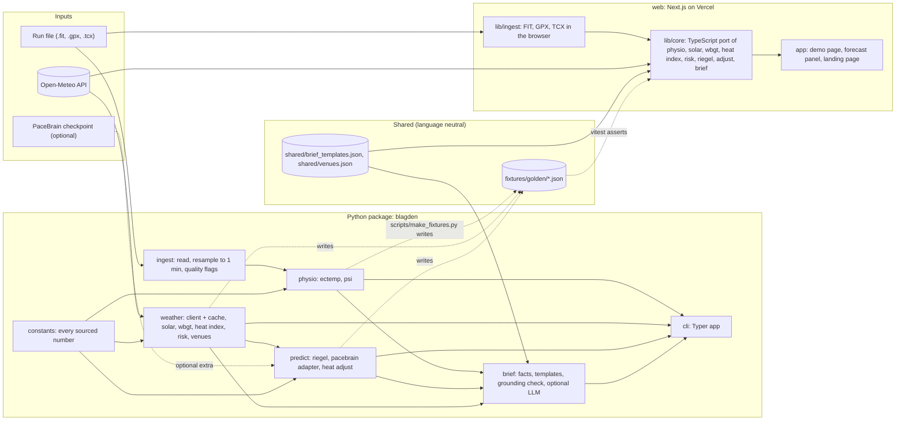

# Blagden architecture

This document describes how Blagden is built: the modules, their public interfaces, the data that flows between them, how the Python and TypeScript implementations are kept identical, how everything is tested and deployed, and the day-by-day build plan. The science behind each number is in docs/SCIENCE.md; decisions and their reasons are in docs/DECISIONS.md.

## 1. System overview

Reading the diagram:

- The run file never leaves the device. In the CLI it is read from disk; in the web demo it is parsed in the browser by `lib/ingest` and never uploaded.
- Weather enters from Open-Meteo. The CLI fetches through the Python client with an on-disk cache; the browser fetches directly from the user's device (D-003, D-010).
- Python is the reference implementation. The TypeScript core is a port, and the golden fixtures are the contract between them (section 4).
- `constants` is the single place where a sourced number lives. Every entry names its section in docs/SCIENCE.md and its status, and a test fails if any UNVERIFIED value is referenced by code.
- Shared JSON files hold the brief templates and venue presets, so both languages read the same text and coordinates.
